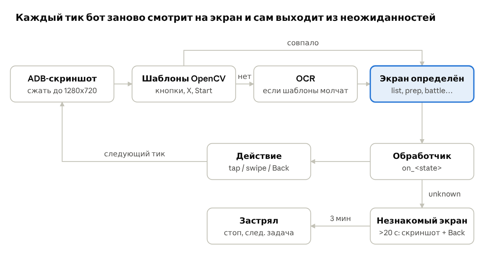

# Ночной бот для Raid: Shadow Legends — как я его сделал

Это не готовая программа, а чертёж: как устроен мой бот, который каждую ночь сам проходит
все дейлики в Raid. Отдайте этот репозиторий LLM (лучше агенту с доступом к терминалу —
Claude Code, Cursor, Codex) и попросите собрать такой же под вашу систему и ваш аккаунт.

> **Боты запрещены правилами Plarium.** Используете на свой риск. Гарантий и поддержки нет —
> это описание того, как я сделал для себя.

## Что умеет бот

Ночью Mac сам просыпается, открывает эмулятор, запускает Raid и делает всё по списку,
потом закрывает игру и пишет HTML-отчёт со скриншотами.

1. **Clan Boss**: забрать сундуки, ударить UNM и NM.
2. **Doom Tower**: фоновый Auto-Climb, отдельно босс, секретные комнаты; после Hard — Normal.
3. **Iron Twins**: фоновый Multi-Battle.
4. **Market**: Mystery Shard за серебро (квест даёт +5 токенов арены).
5. **Classic Arena**: потратить все токены на слабых соперников.
6. **Live Arena**: драфт (пик, бан, лидер) и бой, если окно открыто.
7. **Cursed City**: 8 ключей на открытые этапы.
8. **Grim Forest**: ходит по карте и тратит энергию.
9. **Guardian Ring**: бесплатные апгрейды.
10. **Quests**: CLAIM ALL.
11. **Playtime**: держит игру открытой 3 часа ради наград.

Около 4500 строк Python. Я собрал его примерно за 2,5 недели вместе с Claude Code.

## Что понадобится

- **Android-эмулятор** с установленной Android-версией Raid (ПК-версия не подойдёт):
  BlueStacks Air на Mac (Apple Silicon), BlueStacks 5 / LDPlayer / MuMu на Windows.
- Игра на английском языке, включённый ADB в эмуляторе.
- Python 3 и adb (Android platform-tools).
- Компьютер, который не засыпает ночью (на зарядке).

Подробно — в [docs/setup.md](docs/setup.md).

## Как пользоваться

1. Скормите LLM весь репозиторий: этот README и папку `docs/`. Папка `examples/` — точка старта для кода.
2. Вставьте стартовый промпт:

```text
Это описание бота для Raid: Shadow Legends, которого сделал другой игрок.
Помоги мне собрать похожего бота под мою систему.
Моя система: <macOS / Windows>, эмулятор: <BlueStacks 5 / Air / LDPlayer>,
язык игры: <английский>, нужные мне режимы: <Arena, Clan Boss, ...>.
Начнём с шага 1: подключение по ADB, скриншот, поиск одной кнопки шаблоном
(возьми за основу examples/). Дальше — Classic Arena целиком. Остальные режимы
потом, по одному. После каждого шага скажи, какие скриншоты и кропы кнопок мне сделать.
```

3. Двигайтесь **по одному режиму**: заработало вживую — переходите к следующему.
   Не просите LLM сделать всё сразу.

Три вещи LLM за вас не сделает:
- нарезать с вашего экрана картинки кнопок и героев (шаблоны);
- задать ваши правила: каких героев брать, какие бои пропускать;
- проверить бота на живой игре.

## Содержание

| Файл | Что внутри |
| --- | --- |
| [docs/setup.md](docs/setup.md) | стек, установка, ADB |
| [docs/architecture.md](docs/architecture.md) | главный цикл, шаблоны, OCR, защита от застревания |
| [docs/modes.md](docs/modes.md) | логика каждого режима, координаты |
| [docs/pitfalls.md](docs/pitfalls.md) | грабли, на которые я наступил |
| [docs/schedule.md](docs/schedule.md) | расписание на ночь, перезапуски, отчёт |
| [docs/rules.md](docs/rules.md) | жёсткие правила: гемы, почта, что не нажимать |
| [examples/](examples/) | минимальный рабочий скелет: ADB, шаблоны, OCR, цикл Classic Arena |



## Лицензия

MIT — делайте что хотите, без гарантий.
